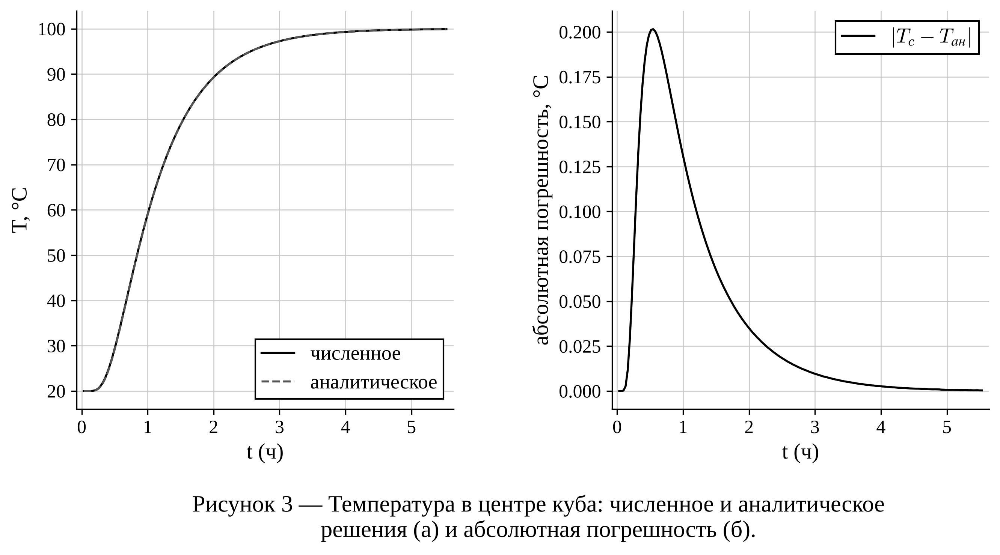
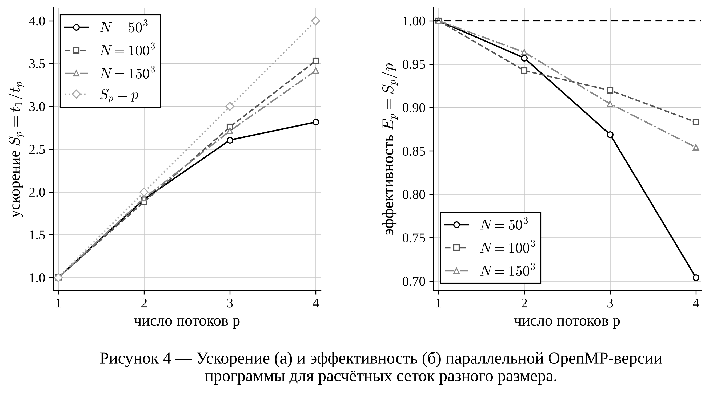
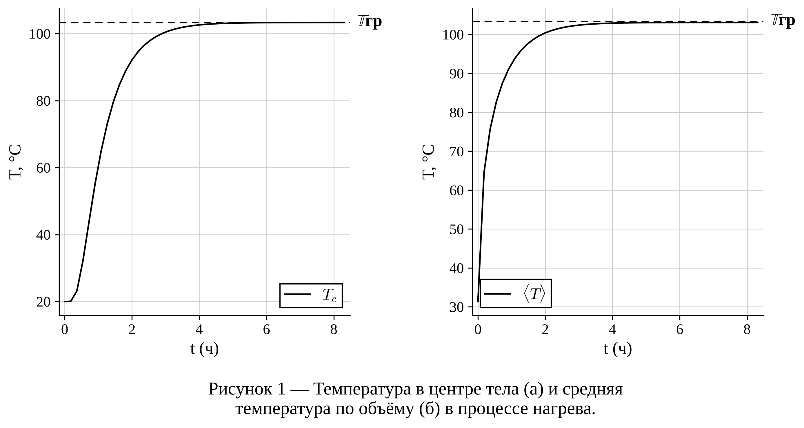
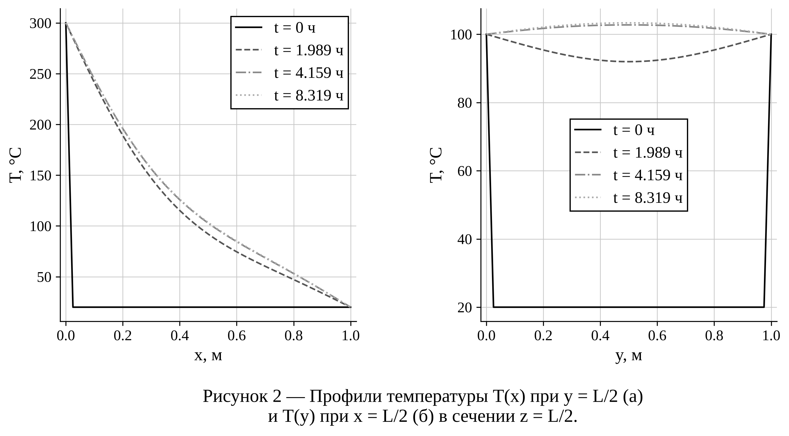

# Отчёт о проделанной работе

**Тема НИР:** Параллельная OpenMP-версия программы для численного моделирования
теплопередачи в сплошных средах.

**Программный комплекс:** HeatSim3D (расчётное ядро `heat3d.cpp` на C++17 + OpenMP,
графический интерфейс `gui.py` на Python/Tkinter, модуль графиков `report_plots.py`).

Документ — рабочий отчёт: что сделано, как проверено, какие получены цифры.
Он служит основой для полноценного отчёта по НИР; в конце приведена
предлагаемая структура вузовского отчёта и соответствие разделов.

---

## 1. Цель и задачи

**Цель:** ускорить расчёт трёхмерного нестационарного температурного поля за счёт
распараллеливания вычислений на многоядерном процессоре средствами OpenMP при
сохранении точности последовательной версии.

**Задачи и статус выполнения:**

| № | Задача | Статус | Где смотреть |
|---|---|---|---|
| 1 | Распараллелить вычислительные циклы схемы FTCS средствами OpenMP | выполнено | `heat3d.cpp`, раздел 4 |
| 2 | Дать управление числом потоков | выполнено, флаг `--threads N` | `heat3d.cpp` |
| 3 | Показать, что параллельная версия считает так же, как последовательная | выполнено, совпадение побитовое | раздел 5.3, `tests/integration/test_openmp.py` |
| 4 | Проверить корректность численной модели (сравнение с аналитическим решением, сходимость) | выполнено | разделы 5.1, 5.2 |
| 5 | Исследовать производительность: время, ускорение, эффективность для разных сеток | выполнено | раздел 6 |
| 6 | Проанализировать факторы, ограничивающие ускорение | выполнено (последовательная запись файлов, пропускная способность памяти) | раздел 6.3 |
| 7 | Обеспечить работу под Linux и Windows | выполнено | раздел 7 |
| 8 | Подготовить графики результатов в оформлении для отчёта | выполнено | раздел 8, `docs/figures/` |

---

## 2. Математическая модель

Рассматривается нестационарная теплопроводность в однородном изотропном твёрдом теле —
кубе $\Omega = [0, L]^3$, $L = 1$ м. Уравнение теплопроводности (Фурье–Кирхгофа)
без внутренних источников:

$$
\frac{\partial T}{\partial t} = \alpha \left( \frac{\partial^2 T}{\partial x^2}
+ \frac{\partial^2 T}{\partial y^2} + \frac{\partial^2 T}{\partial z^2} \right),
\qquad \alpha = \frac{\lambda}{\rho c},
$$

где $T(x,y,z,t)$ — температура, °C; $\alpha$ — коэффициент температуропроводности, м²/с.

**Начальное условие:** $T(x,y,z,0) = T_0$.

**Граничные условия** — первого рода (Дирихле), независимые на каждой из шести граней:
$T|_{x=0} = T_{x-}$, $T|_{x=L} = T_{x+}$, и аналогично по $y$ и $z$.

Материал задаётся значением $\alpha$. В GUI есть библиотека из 9 материалов
(конструкционная и нержавеющая сталь, алюминий, медь, титан, чугун, бетон, гранит, кирпич).

---

## 3. Численный метод

Используется явная конечно-разностная схема FTCS (Forward Time, Central Space) на
равномерной декартовой сетке $N_x \times N_y \times N_z$, шаги
$h_x = L/(N_x-1)$ и аналогично по $y$, $z$:

$$
T^{n+1}_{i,j,k} = T^n_{i,j,k}
+ r_x\,(T^n_{i+1,j,k} - 2T^n_{i,j,k} + T^n_{i-1,j,k})
+ r_y\,(T^n_{i,j+1,k} - 2T^n_{i,j,k} + T^n_{i,j-1,k})
+ r_z\,(T^n_{i,j,k+1} - 2T^n_{i,j,k} + T^n_{i,j,k-1}),
$$

$$
r_x = \frac{\alpha\,\Delta t}{h_x^2},\quad r_y = \frac{\alpha\,\Delta t}{h_y^2},\quad r_z = \frac{\alpha\,\Delta t}{h_z^2}.
$$

Схема имеет первый порядок аппроксимации по времени и второй — по пространству.

**Условие устойчивости:** $2(r_x + r_y + r_z) \le 1$. Шаг по времени выбирается
автоматически с запасом 0,4:

$$
\Delta t = \frac{0{,}4}{2\alpha\,(1/h_x^2 + 1/h_y^2 + 1/h_z^2)},
$$

то есть $2(r_x + r_y + r_z) = 0{,}4$. Значение выводится в консоль при каждом запуске.

**Свойство, важное для распараллеливания.** Новое значение в каждом узле зависит только
от значений *предыдущего* слоя. Поэтому все $(N_x-2)(N_y-2)(N_z-2)$ внутренних узлов
одного шага можно вычислять независимо и в любом порядке. Это идеальная задача для
параллелизма по данным.

---

## 4. Программная реализация параллельной версии

### 4.1. Структура данных

Поле хранится в одномерном массиве `std::vector<double>` длины $N_x N_y N_z$ с
индексацией `idx(i,j,k) = i·Ny·Nz + j·Nz + k`: индекс $k$ меняется быстрее всех,
поэтому внутренний цикл идёт по памяти подряд. Используются два буфера, `T` (слой $n$)
и `T_new` (слой $n+1$), которые после каждого шага меняются местами через
`std::swap` за O(1).

### 4.2. Что распараллелено

| Участок | Директива OpenMP | Доля работы |
|---|---|---|
| Обновление внутренних узлов (основной цикл схемы) | `#pragma omp parallel for schedule(static)` по слитому индексу `(i,j)` | ≈ 99 % вычислений |
| Граничные условия на 6 гранях (`applyBC`) | `#pragma omp parallel for schedule(static)` на каждую пару граней | O(N²) за шаг |
| Средняя температура по объёму (`meanTemp`) | `#pragma omp parallel for reduction(+:sum)` | при каждой записи результатов |

**Основной цикл.** Циклы по `i` и `j` слиты вручную в один цикл по `ij` от 0 до
$(N_x-2)(N_y-2)$. Внутри восстанавливаются `i = 1 + ij / (Ny-2)` и
`j = 1 + ij % (Ny-2)`, а цикл по `k` остаётся последовательным внутри потока. Почему так:

- слитое пространство итераций велико ($48^2 = 2304$ уже при сетке $50^3$), поэтому
  работа делится между потоками равномерно даже на маленьких сетках;
- внутренний цикл по `k` идёт по памяти подряд и хорошо векторизуется компилятором;
- ручное слияние эквивалентно `collapse(2)`, но работает и на OpenMP 2.0: обычный
  ключ `/openmp` в Visual Studio поддерживает только эту версию, а `collapse` появился
  в OpenMP 3.0.

**Отсутствие гонок данных.** Каждый элемент `T_new` записывается ровно одним потоком,
массив `T` во время шага только читается. Синхронизация нужна лишь в конце шага: перед
заменой буферов. Её обеспечивает неявный барьер в конце `parallel for`.

**`schedule(static)`.** Объём работы на итерацию одинаков, поэтому статическое
распределение даёт равную нагрузку без накладных расходов динамического планировщика.

**Редукция при вычислении средней температуры.** Сумма по объёму считается через
`reduction(+:sum)`: у каждого потока своя частичная сумма, в конце они складываются.
Из-за другого порядка сложения результат может отличаться от последовательного в
последних знаках (~1e-13). На выводимые 4 знака это не влияет.

### 4.3. Управление числом потоков и вывод

- Флаг `--threads N` вызывает `omp_set_num_threads(N)`. Если флаг не задан, OpenMP
  берёт все доступные ядра, либо значение переменной `OMP_NUM_THREADS`.
- Фактическое число потоков печатается в заголовке (`Threads : N`) и пишется в
  `output/params.csv` вместе со всеми параметрами расчёта и временем счёта.
- Если собрать программу без OpenMP (без `-fopenmp` или `/openmp`), получится
  последовательная версия: директивы игнорируются, а код ветвей `#ifdef _OPENMP`
  исключается.

### 4.4. Время счёта

Измеряется `std::chrono::high_resolution_clock` от начала цикла по времени до его конца:
сюда входят вычисления и запись результатов. Выделение памяти и разбор аргументов в
замер не входят.

---

## 5. Проверка корректности

### 5.1. Сравнение с аналитическим решением

Для куба с одинаковой температурой $T_b$ на всех гранях и начальной $T_0$ решение
известно в виде ряда Фурье. В центре куба:

$$
T_c(t) = T_b + (T_0 - T_b)\,\frac{64}{\pi^3}
\left( \sum_{k=1,3,5,\dots} \frac{(-1)^{(k-1)/2}}{k}\,
e^{-\alpha \pi^2 k^2 t / L^2} \right)^{3}.
$$

Ряд распадается на произведение трёх одинаковых одномерных рядов; в расчёте взято
20 нечётных членов (`report_plots.analytic_center`).

**Параметры:** сетка $31^3$, сталь $\alpha = 1{,}28\cdot10^{-5}$ м²/с, $T_0 = 20$ °C,
$T_b = 100$ °C, $t_{end} = 20000$ с.

**Результат (рисунок 3):** кривые численного и аналитического решений визуально
совпадают. Максимальная абсолютная погрешность — **0,20 °C** при $t \approx 0{,}55$ ч
(0,25 % от перепада 80 °C). К установившемуся режиму погрешность стремится к нулю.



### 5.2. Сходимость по сетке

Погрешность температуры в центре в момент $t = 4000$ с (численное значение
линейно интерполировано между сохранёнными шагами; $\Delta t$ выбирается автоматически):

| Сетка | $h$, м | $\lvert T_c - T_{ан}\rvert$, °C | Отношение к предыдущей |
|---|---|---|---|
| $11^3$ | 0,1000 | 1,0113 | — |
| $21^3$ | 0,0500 | 0,2543 | 3,98 |
| $41^3$ | 0,0250 | 0,0636 | 4,00 |
| $81^3$ | 0,0125 | 0,0159 | 4,00 |

При уменьшении шага вдвое погрешность уменьшается в 4 раза. Это подтверждает **второй
порядок точности** по пространству. Шаг по времени связан с шагом по пространству
условием $\Delta t \sim h^2$, поэтому вклад первого порядка по времени тоже масштабируется
как $h^2$.

### 5.3. Совпадение параллельной и последовательной версий

Одна и та же задача (сетка $20^3$, несимметричные граничные условия) считалась с 1 и с 4
потоками. Все файлы срезов `slice_*.csv` и `history.csv` **совпали побитно**. Так и должно
быть: каждый узел вычисляется по той же формуле с теми же операндами, меняется только
то, какой поток его считает.

Windows-сборка (`heat3d.exe`, MinGW, запуск через Wine) дала те же самые числа. Файлы
отличаются только переводом строки (CRLF вместо LF).

### 5.4. Автотесты

Файл `tests/integration/test_openmp.py` (pytest), 6 тестов, все проходят:

| Тест | Что проверяет |
|---|---|
| `test_result_independent_of_threads` | поле при 1 и 4 потоках совпадает побитно |
| `test_threads_flag[1,2,3]` | `--threads N` реально задаёт N потоков (stdout и `params.csv`) |
| `test_matches_analytic_solution` | отклонение от аналитики на сетке $31^3$ < 0,5 °C |
| `test_windows_build_matches_linux` | Windows-сборка даёт те же числа (если есть mingw-w64 и wine) |

Модульные тесты ядра из прошлого семестра (`tests/unit/test_heat3d_units.cpp`)
тоже проходят: 13 / 13.

---

## 6. Исследование производительности

### 6.1. Методика

- **Оборудование:** Intel Xeon @ 2,10 ГГц, 4 ядра (1 поток на ядро), Linux, x86-64.
- **Компилятор:** g++ 13.3, флаги `-O2 -fopenmp -std=c++17`.
- **Задача:** куб $N^3$ при $N$ = 50, 100, 150 (от 125 тыс. до 3,4 млн узлов),
  **1000 шагов** по времени на каждой сетке (`t_end` подбирается под нужное число
  шагов), запись промежуточных результатов отключена.
- **Потоки:** p = 1, 2, 3, 4.
- **Каждая точка** — минимум из 5 запусков: так отсекаются случайные помехи от других
  процессов.
- **Метрики:** ускорение $S_p = t_1 / t_p$ и эффективность $E_p = S_p / p$.

Замер воспроизводится одной командой:

```
python report_plots.py --bench --threads 1 2 3 4 --nx 50 100 150 --steps 1000 --repeat 5
```

Сырые данные: `docs/data/benchmark.csv`.

### 6.2. Результаты

| Сетка | Узлов | $t_1$, с | $t_2$, с | $t_3$, с | $t_4$, с | $S_4$ | $E_4$ |
|---|---|---|---|---|---|---|---|
| $50^3$ | 125 000 | 0,245 | 0,128 | 0,094 | 0,087 | 2,82 | 0,70 |
| $100^3$ | 1 000 000 | 2,017 | 1,070 | 0,731 | 0,571 | 3,53 | 0,88 |
| $150^3$ | 3 375 000 | 6,535 | 3,391 | 2,409 | 1,913 | 3,42 | 0,85 |

Ускорение при 2 потоках — 1,89–1,93, при 3 потоках — 2,61–2,76.

Последовательная сборка без OpenMP на сетке $100^3$ считает за 2,02 с, столько же,
сколько OpenMP-версия с одним потоком. Значит, накладные расходы OpenMP пренебрежимо малы.



**Наблюдения:**

1. На средних и больших сетках ($10^6$ узлов и более) эффективность при 4 потоках
   держится на уровне **0,85–0,88**, ускорение — **3,4–3,5 раза**.
2. На маленькой сетке $50^3$ эффективность падает до 0,70. Шаг считается за доли
   миллисекунды, и становятся заметны постоянные издержки: запуск и барьерная
   синхронизация потоков (4 параллельные области на шаг, около 4000 барьеров
   за расчёт), а также последовательная часть (обмен буферами, проверка условий записи).
3. Расхождение между $100^3$ и $150^3$ (3,53 против 3,42) лежит в пределах разброса
   замеров (около 5–10 %). Существенной разницы между этими сетками нет.
4. Почему ускорение не достигает идеального $S_p = p$: схема FTCS — задача,
   **ограниченная пропускной способностью памяти**. На каждый узел приходится около
   10 арифметических операций и обращение к 7 значениям массива. С ростом числа потоков
   ядра начинают делить общую шину памяти и кэш последнего уровня.

### 6.3. Влияние записи результатов (закон Амдала)

Запись срезов в CSV выполняется **последовательно**, одним потоком. Сетка $100^3$,
996 шагов:

| Запись каждые | $t_1$, с | $t_4$, с | $S_4$ |
|---|---|---|---|
| не записывать | 1,92 | 0,54 | 3,57 |
| 100 шагов (10 записей) | 2,05 | 0,71 | 2,89 |
| 20 шагов (50 записей) | 2,81 | 1,61 | 1,74 |

По закону Амдала $S_p = 1 / (f + (1-f)/p)$. При записи каждые 20 шагов это даёт
последовательную долю $f \approx 0{,}43$. Вывод для пользователя: при длинных расчётах
интервал записи (`save_every`) стоит выбирать так, чтобы записей было десятки, а не сотни.
Иначе выигрыш от параллелизма съедает дисковый ввод-вывод.

---

## 7. Кроссплатформенность (Linux и Windows)

| | Linux | Windows |
|---|---|---|
| Ядро | `heat3d` (ELF x86-64) | `heat3d.exe` (PE32+ x86-64, статически, без DLL) |
| Сборка ядра | `./build_linux.sh engine` | `build_exe.bat` (MinGW) / Visual Studio `/openmp` / из Linux `./build_windows_cross.sh` |
| Сборка GUI | `./build_linux.sh` → `dist/HeatSim3D` | `build_exe.bat` → `dist\HeatSim3D.exe` |

- Платформенные различия в исходнике ограничены созданием каталога
  (`_mkdir` на Windows, `mkdir` на POSIX) под `#ifdef _WIN32`.
- GUI и `report_plots.py` выбирают имя ядра по ОС: `heat3d.exe` при `os.name == "nt"`,
  иначе `heat3d`.
- PyInstaller-спецификация `HeatSim3D.spec` тоже выбирает ядро под ОС сборки.
- Windows-ядро собрано кросс-компилятором mingw-w64 (GCC 13) с ключом `-static`, поэтому
  `libgomp` и `libstdc++` встроены в exe.
- **Проверено:** Windows-ядро запущено под Wine 9.0. Флаг `--threads` работает, а
  результаты побитно совпадают с Linux-версией (тест `test_windows_build_matches_linux`).
  На настоящей Windows запуск ещё нужно проверить (см. раздел 10).

---

## 8. Визуализация результатов для отчёта

Модуль `report_plots.py` строит рисунки в едином «журнальном» оформлении:

- белый фон, чёрные или серые линии, которые различаются типом штриха и маркерами,
  поэтому рисунок читается и при чёрно-белой печати;
- шрифт с засечками, формулы в LaTeX-стиле;
- пара графиков (а) и (б) с общей подписью «Рисунок N — …»;
- линия-ориентир с подписью справа ($\mathbb{T}$гр — температура граней);
- PNG 300 dpi и векторный PDF.

| Рисунок | Файл | Содержание |
|---|---|---|
| 1 | `docs/figures/fig_history` | $T$ в центре (а) и средняя по объёму (б) от времени |
| 2 | `docs/figures/fig_profiles` | профили $T(x)$ и $T(y)$ в несколько моментов времени |
| 3 | `docs/figures/fig_validation` | численное и аналитическое решения (а), погрешность (б) |
| 4 | `docs/figures/fig_speedup` | ускорение (а) и эффективность (б) для сеток $50^3$, $100^3$, $150^3$ |

Рисунки 1–2 построены по расчёту с несимметричными гранями: сетка $41^3$, $T_0 = 20$ °C,
$T_{x-} = 300$, $T_{x+} = 20$, $T_{y\pm} = 100$, $T_{z\pm} = 50$ °C, $t_{end} = 30000$ с.
В установившемся режиме температура в центре стремится к средней по граням
($\approx 103{,}3$ °C). Так и должно быть для уравнения Лапласа в кубе: по симметрии каждая
грань вносит в центр 1/6 своей температуры.




Использование:

```
python report_plots.py output --num 3.5 --fmt png pdf   # по результатам расчёта
python report_plots.py --bench --nx 50 100 150          # замер ускорения
```

В GUI для этого есть кнопки «Графики для отчёта» и «Замер ускорения OpenMP».

---

## 9. Перечень изменений в программе за семестр

| Файл | Изменение |
|---|---|
| `heat3d.cpp` | OpenMP: параллельный основной цикл (слияние `i,j`), граничные условия, редукция средней T; флаг `--threads`; вывод числа потоков; запись `params.csv`; инструкции по сборке в шапке |
| `heat3d`, `heat3d.exe` | собранные ядра под Linux и Windows с OpenMP |
| `report_plots.py` | новый модуль: графики для отчёта, аналитическое решение, замер ускорения |
| `gui.py` | выбор ядра по ОС, кнопки «Графики для отчёта» и «Замер ускорения OpenMP» |
| `build_linux.sh`, `build_windows_cross.sh`, `build_exe.bat`, `HeatSim3D.spec` | сборка под обе ОС |
| `tests/integration/test_openmp.py` | автотесты параллельной версии |
| `docs/figures/`, `docs/data/` | рисунки и исходные данные замеров |

---

## 10. Ограничения и что осталось сделать

1. **Замеры выполнены на 4-ядерной машине.** Для отчёта желательно повторить
   `report_plots.py --bench` на своём компьютере: на 8–16 потоках картина насыщения по
   памяти будет нагляднее. Команда и рисунок формируются автоматически.
2. **Windows-сборка проверена под Wine, не на настоящей Windows.** Перед защитой стоит
   запустить `heat3d.exe` и `python gui.py` на Windows.
3. **GUI в этом окружении не запускался** (нет `tkinter`). Код кнопок проверен на
   синтаксис, функции модуля графиков — отдельно. Кнопки нужно один раз нажать вручную.
4. **Запись результатов остаётся последовательной** (раздел 6.3). Возможное развитие:
   писать в отдельном потоке, пока считается следующий шаг, или перейти на бинарный формат.
5. **Возможные направления развития:** блочная (тайловая) обработка для лучшего
   использования кэша, неявная схема (Кранк–Николсон) с параллельным решателем,
   гибрид MPI+OpenMP для кластера, граничные условия II и III рода.

---

## 11. Выводы

1. Разработана параллельная OpenMP-версия программы моделирования трёхмерной
   нестационарной теплопроводности. Распараллелены основной цикл явной схемы FTCS,
   наложение граничных условий и вычисление средней температуры.
2. Параллельная версия даёт результаты, **побитно совпадающие** с последовательной,
   при любом числе потоков и на обеих платформах (Linux и Windows).
3. Численная модель верифицирована по аналитическому решению: погрешность 0,25 % на
   сетке $31^3$. Подтверждён второй порядок сходимости по пространству.
4. На 4-ядерном процессоре получено ускорение до **3,5 раза** (эффективность 0,85–0,88)
   на сетках от $10^6$ узлов. На малых сетках эффективность ниже (0,70) из-за накладных
   расходов синхронизации.
5. Основные ограничения масштабируемости — пропускная способность памяти и
   последовательная запись результатов. Последнюю можно уменьшить правильным выбором
   интервала сохранения.
6. Программа собирается и работает под Linux и Windows, а для результатов есть
   инструмент построения графиков в оформлении для отчёта.

---

## Приложение. Предлагаемая структура вузовского отчёта по НИР

| Раздел отчёта | Источник в этом документе |
|---|---|
| Введение (актуальность, цель, задачи) | раздел 1; актуальность: рост размеров сеток в 3D, многоядерность современных ПК |
| 1. Обзор: модели теплопроводности, методы распараллеливания (OpenMP, MPI, CUDA), закон Амдала | разделы 2, 6.3 (дополнить литературой) |
| 2. Математическая модель и численный метод | разделы 2, 3 |
| 3. Разработка параллельной версии (структура данных, анализ зависимостей, директивы OpenMP, кроссплатформенность) | разделы 4, 7 |
| 4. Верификация и тестирование | раздел 5, рисунок 3 |
| 5. Вычислительный эксперимент: результаты моделирования и исследование производительности | разделы 6, 8, рисунки 1, 2, 4 |
| Заключение | раздел 11 |
| Приложения: листинг `heat3d.cpp`, таблицы замеров | `heat3d.cpp`, `docs/data/benchmark.csv` |

Рисунки нумеруются под главу командой
`python report_plots.py <папка> --num 3.1`: тогда получатся «Рисунок 3.1», «3.2» и т. д.
